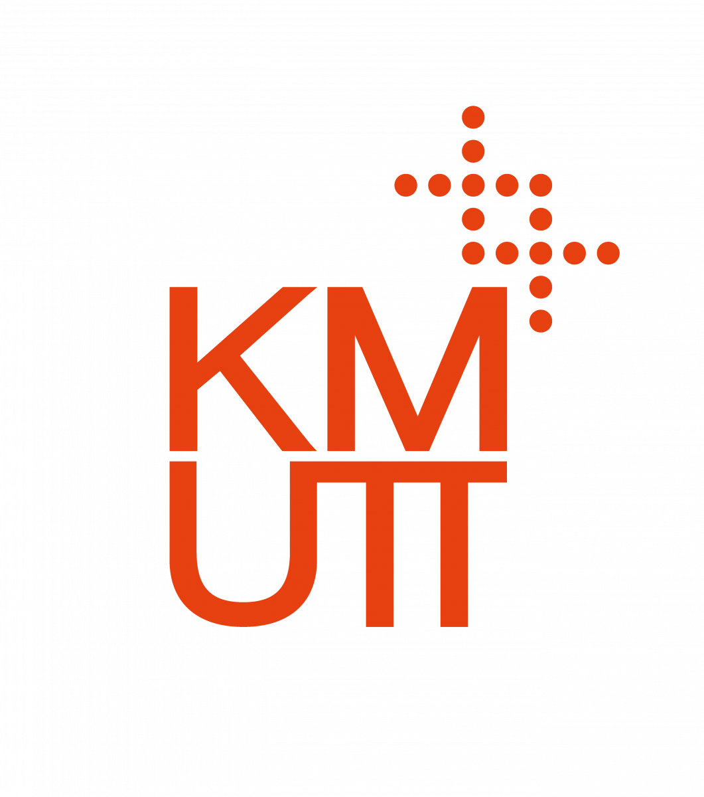

# 🎓 Research Topics & Researchers Explorer

An interactive, single-page web dashboard designed for exploring academic research topics, expert author profiles, and publication portfolios derived from topic clustering models at **KMUTT (King Mongkut's University of Technology Thonburi)**.

---

## 🌟 Key Features

* **3-Column**:
  * **Column 1 (Topics)**: Search and browse clustered research topics with paper counts and keywords.
  * **Column 2 (Researchers)**: Explore author expertise ranks, paper volumes, and portfolio concentration percentages.
  * **Column 3 (Papers)**: Review matching publications with publication years, citation counts, and clickable abstract view.
* **Researcher Topic Group (Bottom Overview)**: Displays an author's complete topic distribution with interactive badges for instant context switching.
* **Instant Hover Tooltips**: Displays detailed topic summaries and metrics context seamlessly on hover.

---

## 📊 Metric Explanations

### Column 2: Researcher Expertise Metrics

* **Topic Share (%)**: The percentage of a researcher's **total career publications** concentrated within the selected research topic.
  $$\text{Topic Share} = \left( \frac{\text{Papers in Selected Topic}}{\text{Total Career Papers}} \right) \times 100$$
* **Top Expertise #1–5**: Highlights the author's **top 5 primary fields of research** ranked by publication volume.
* **Expertise #6+**: Indicates secondary or broader contributing research topics in the author's overall portfolio.

---